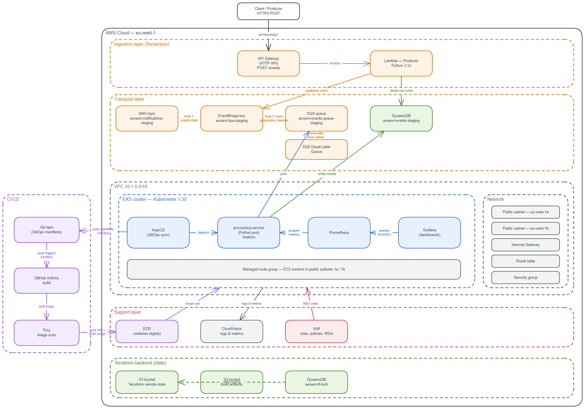

# AWS Event Platform

Serverless + Kubernetes event platform on AWS.

## Architecture

Full details in [`docs/architecture.md`](docs/architecture.md).

## Stack

- **Serverless layer:** API Gateway + Lambda + DynamoDB + SQS + EventBridge
- **Kubernetes layer:** EKS + ArgoCD (GitOps) + Prometheus + Grafana
- **IaC:** Terraform (modular, staging + prod)
- **CI/CD:** GitHub Actions → ECR → ArgoCD

## Region

`eu-west-1` (Ireland)

## Status

Work in progress.

<- Fixed SQS resource policy to allow EventBridge to send Trigger CI/CD re-run -->
