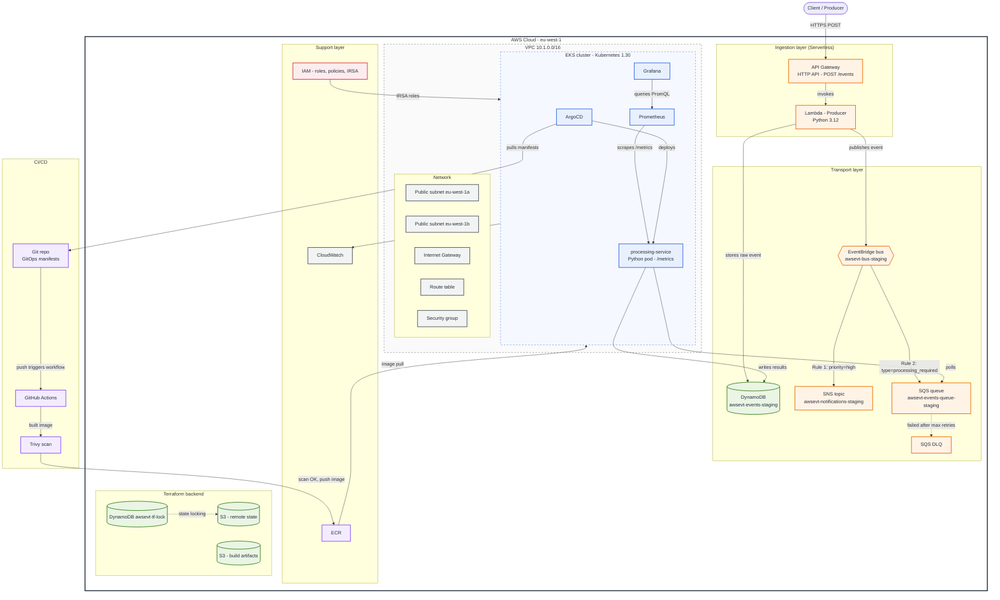

# AWS Event Platform — architecture diagram

## 1. Mermaid

## 2. Excalidraw

Open `aws-event-platform.excalidraw` in excalidraw.com (File → Open) or drag it onto the canvas.

Colors: Serverless orange · Kubernetes blue · Data green · Security red · CI/CD purple · Network/CloudWatch gray.

### Boxes

| Label | Layer | Position (x, y) | Type |
|---|---|---|---|
| Client / Producer — HTTPS POST | Client | (860, 20) | client |
| API Gateway — (HTTP API) — POST /events | Ingestion | (860, 190) | sls |
| Lambda — Producer — Python 3.12 | Ingestion | (1330, 190) | sls |
| SNS topic — awsevt-notifications- — staging | Transport | (430, 385) | sls |
| EventBridge bus — awsevt-bus-staging | Transport | (730, 385) | sls |
| SQS queue — awsevt-events-queue- — staging | Transport | (1030, 385) | sls |
| SQS Dead-Letter — Queue | Transport | (1030, 505) | sls |
| DynamoDB — awsevt-events-staging | Transport | (1330, 385) | data |
| ArgoCD — (GitOps sync) | EKS | (470, 780) | k8s |
| processing-service — (Python pod) — /metrics | EKS | (790, 780) | k8s |
| Prometheus | EKS | (1110, 780) | k8s |
| Grafana — (dashboards) | EKS | (1430, 780) | k8s |
| Managed node group — EC2 workers in public subnets 1a / 1b | EKS | (470, 930) | gray |
| Public subnet — eu-west-1a | Network (VPC) | (1760, 740) | gray |
| Public subnet — eu-west-1b | Network (VPC) | (1760, 798) | gray |
| Internet Gateway | Network (VPC) | (1760, 856) | gray |
| Route table | Network (VPC) | (1760, 914) | gray |
| Security group | Network (VPC) | (1760, 972) | gray |
| ECR — container registry | Support | (430, 1145) | cicd |
| CloudWatch — logs & metrics | Support | (730, 1145) | gray |
| IAM — roles, policies, IRSA | Support | (1030, 1145) | sec |
| S3 bucket — Terraform remote state | Backend | (430, 1325) | data |
| S3 bucket — build artifacts | Backend | (730, 1325) | data |
| DynamoDB — awsevt-tf-lock | Backend | (1030, 1325) | data |
| Git repo — (GitOps manifests) | CI/CD | (70, 780) | cicd |
| GitHub Actions — build | CI/CD | (70, 960) | cicd |
| Trivy — image scan | CI/CD | (70, 1145) | cicd |

### Arrows

| From | To | Label |
|---|---|---|
| Client / Producer HTTPS POST | API Gateway (HTTP API) POST /events | HTTPS POST |
| API Gateway (HTTP API) POST /events | Lambda — Producer Python 3.12 | invokes |
| Lambda — Producer Python 3.12 | DynamoDB awsevt-events-staging | stores raw event |
| Lambda — Producer Python 3.12 | EventBridge bus awsevt-bus-staging | publishes event |
| EventBridge bus awsevt-bus-staging | SNS topic awsevt-notifications- staging | Rule 1: priority=high |
| EventBridge bus awsevt-bus-staging | SQS queue awsevt-events-queue- staging | Rule 2: type= processing_required |
| SQS queue awsevt-events-queue- staging | SQS Dead-Letter Queue | failed after max retries |
| processing-service (Python pod) /metrics | SQS queue awsevt-events-queue- staging | polls |
| processing-service (Python pod) /metrics | DynamoDB awsevt-events-staging | writes results |
| Prometheus | processing-service (Python pod) /metrics | scrapes /metrics |
| Grafana (dashboards) | Prometheus | queries (PromQL) |
| ArgoCD (GitOps sync) | processing-service (Python pod) /metrics | deploys |
| ArgoCD (GitOps sync) | Git repo (GitOps manifests) | pulls manifests (GitOps) |
| Git repo (GitOps manifests) | GitHub Actions build | push triggers workflow |
| GitHub Actions build | Trivy image scan | built image |
| Trivy image scan | ECR container registry | scan OK → push image |
| ECR container registry | EKS cluster | image pull |
| IAM roles, policies, IRSA | EKS cluster | IRSA roles |
| EKS cluster | CloudWatch logs & metrics | logs & metrics |
| DynamoDB awsevt-tf-lock | S3 bucket Terraform remote state | state locking |

## 3. Caption

**Figure 1.** AWS Event Platform (eu-west-1) — a hybrid serverless and Kubernetes architecture. Clients send events over HTTPS to an API Gateway HTTP API, which invokes a Python 3.12 Lambda producer that validates each event, stores it in DynamoDB and publishes it to a custom EventBridge bus. Content-based rules fan high-priority events out to SNS for email/Slack notifications and route events that need processing to an SQS queue backed by a dead-letter queue. A processing-service pod on Amazon EKS (Kubernetes 1.30) polls the queue and writes results back to DynamoDB, while Prometheus and Grafana provide observability and ArgoCD keeps the cluster in sync with Git. GitHub Actions builds, scans (Trivy) and pushes images to ECR, IAM roles for service accounts secure pod access to AWS, CloudWatch collects logs and metrics, and Terraform state lives in S3 with DynamoDB locking, all inside a VPC (10.1.0.0/16) spanning two public subnets.
